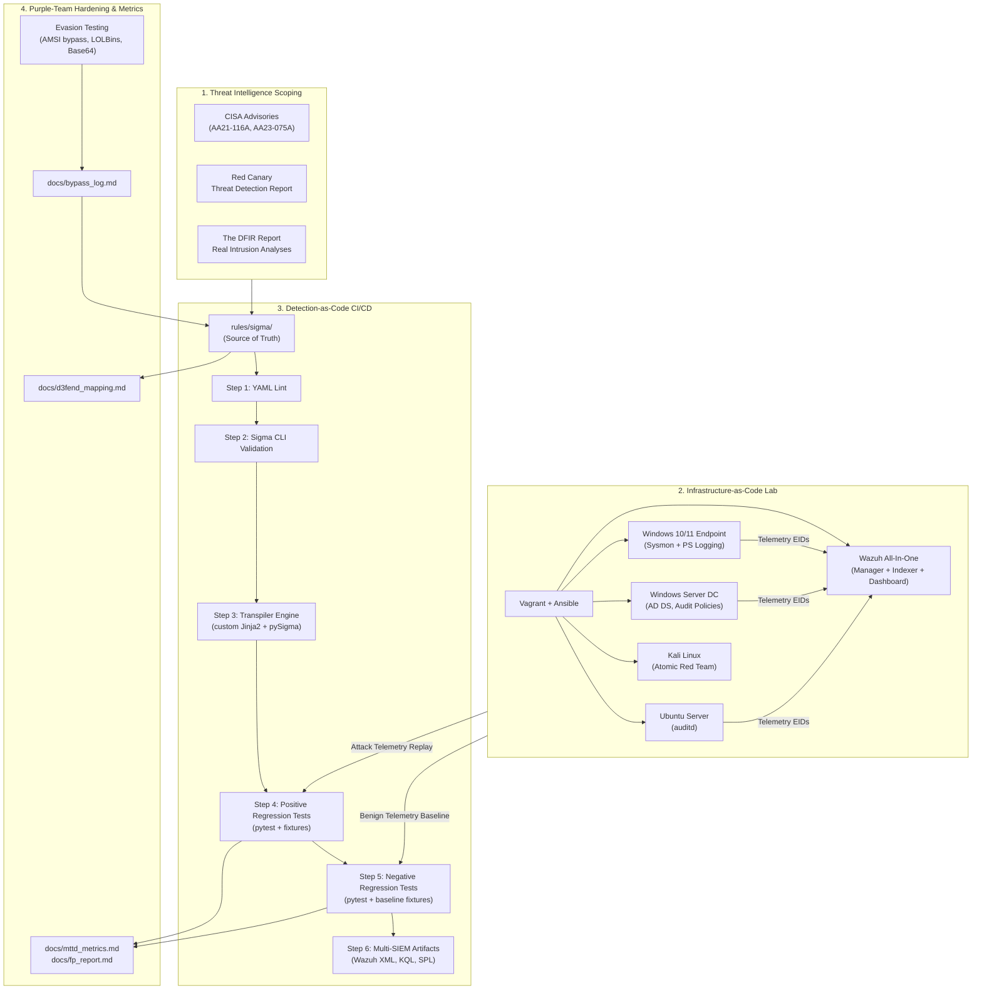

# Threat-Informed Detection Engineering Lab & Portfolio

[](https://github.com/omar-riadd/detection-engineering-lab/actions/workflows/ci.yml)
[](rules/sigma/)
[](docs/scope.md)
[](docs/d3fend_mapping.md)
[](LICENSE)

> A production-grade, metrics-driven detection engineering portfolio demonstrating a threat-informed lifecycle: from threat intelligence scoping and infrastructure-as-code lab provisioning, to Sigma rule authoring, multi-SIEM transpilation, purple-team adversarial validation, and automated CI/CD regression testing.

---

## 1. Executive Summary & Architecture

This project implements an end-to-end Detection-as-Code (DaC) engineering pipeline. Detections are authored strictly in vendor-neutral **Sigma (YAML)**, validated through an automated CI/CD harness in GitHub Actions, transpiled to native SIEM formats (**Wazuh XML**, **Microsoft Sentinel KQL**, and **Splunk SPL**), and continuously verified against replayable positive (attack) and negative (benign baseline) JSON log fixtures.

### Telemetry & Pipeline Architecture



---

## 2. Attack Scenarios & Scope

The lab focuses on two primary attack chains documented in enterprise threat intelligence:

1. **Scenario A — Active Directory Intrusion Chain** (APT29 / CISA AA21-116A):
   - Spearphishing attachment payload staging (`T1566.001`)
   - User execution (`T1204.002`) & malicious PowerShell execution (`T1059.001`)
   - Defense evasion via Rundll32 proxy execution (`T1218.011`) & process hollowing (`T1055.012`)
   - Credential dumping: LSASS memory access (`T1003.001`) & DCSync replication (`T1003.006`)
   - Discovery: Domain accounts (`T1087.002`) & Domain trust enumeration (`T1482`)
   - Lateral movement: SMB / Administrative shares (`T1021.002`)

2. **Scenario B — Ransomware Precursor Chain** (Conti / Black Basta / LockBit):
   - Initial ingress via valid domain accounts (`T1078.002`) & RDP access (`T1021.001`)
   - Persistence: Scheduled tasks (`T1053.005`) & Registry Run keys (`T1547.001`)
   - Defense impairment: Disabling Microsoft Defender (`T1562.001`) & WMI manipulation (`T1047`)
   - Inhibiting system recovery: Volume shadow copy & backup catalog deletion (`T1490`)
   - Command obfuscation (`T1027`) & C2 exfiltration (`T1041`)
   - High-velocity mass file encryption (`T1486`)

*Detailed technical scopes, telemetry event IDs, and laboratory simulation boundaries are fully documented in [docs/scope.md](docs/scope.md).*

---

## 3. Metrics & Engineering Targets

| Metric | Target | Current Status | Tracking Location |
|---|---|---|---|
| **Total Sigma Detections** | 25–30 Rules | Planning (0/25) | [`rules/sigma/`](rules/sigma/) |
| **ATT&CK Sub-Techniques** | 20+ Sub-techniques | 20 Scoped | [`docs/scope.md`](docs/scope.md) |
| **True Positive (TP) Rate** | > 90% | Tracking | [`docs/fp_report.md`](docs/fp_report.md) |
| **False Positive (FP) Rate** | < 2% | Tracking | [`docs/fp_report.md`](docs/fp_report.md) |
| **Mean Time to Detect (MTTD)** | < 60 seconds | Tracking | [`docs/mttd_metrics.md`](docs/mttd_metrics.md) |
| **Adversarial Bypasses Evaluated** | 5–10 Evasions | Tracking | [`docs/bypass_log.md`](docs/bypass_log.md) |
| **Adversarial Bypasses Mitigated** | 100% of discovered | Tracking | [`docs/bypass_log.md`](docs/bypass_log.md) |
| **Multi-SIEM Translation Coverage** | Wazuh XML, KQL, SPL | Pipeline Scoped | [`converted/`](converted/) |
| **D3FEND Countermeasures Mapped** | 100% of rules | Structure Set | [`docs/d3fend_mapping.md`](docs/d3fend_mapping.md) |
| **Hypothesis Threat Hunting Playbooks**| 2 Comprehensive Playbooks| Planned | [`playbooks/`](playbooks/) |

---

## 4. Repository Layout

```
detection-engineering-lab/
├── .github/workflows/ci.yml           # Automated CI: lint -> validate -> convert -> test
├── infra/                             # Infrastructure-as-Code provisioning
│   ├── Vagrantfile                    # Multi-machine VirtualBox topology
│   ├── ansible/                       # Configuration playbooks for Wazuh, DC, Windows, Linux
│   └── scripts/                       # Sysmon installer, auditd configuration, PS logging
├── rules/
│   ├── sigma/                         # Primary source of truth for detections
│   └── wazuh/                         # Auto-transpiled Wazuh XML rules
├── converted/                         # Auto-transpiled multi-SIEM outputs
│   ├── kql/                           # Microsoft Sentinel / Defender queries
│   └── splunk/                        # Splunk Search Processing Language (SPL)
├── tests/
│   ├── fixtures/                      # Labeled JSON log samples (positive/negative)
│   └── test_detections.py             # Pytest regression suite
├── runbooks/                          # Tier-1/Tier-2 SOC triage runbooks
├── playbooks/                         # Hypothesis-driven threat hunting playbooks
├── emulation/                         # Attack simulation scripts & Atomic mappings
├── docs/                              # Project documentation, bypass logs, and metrics
└── scripts/                           # Transpiler, log replay, and baseline generation
```

---

## 5. Quick Start & Execution

### Prerequisites
- Python 3.10+
- Git
- VirtualBox & Vagrant (for lab deployment)

### Running CI Validation Locally
```bash
# Install dependencies
pip install pysigma sigma-cli pyyaml pytest jinja2

# Run YAML syntax linting
python -c "import yaml, glob; [yaml.safe_load(open(f)) for f in glob.glob('rules/sigma/**/*.yml', recursive=True)]"

# Run Sigma validation
sigma check rules/sigma/

# Transpile rules to multi-SIEM formats
python scripts/convert_sigma.py --input rules/sigma/ --wazuh rules/wazuh/ --kql converted/kql/ --splunk converted/splunk/

# Run regression test harness
pytest tests/ -v
```

---

## 6. Project Roadmap

Refer to [Project_progress.md](Project_progress.md) for the live week-by-week implementation status and execution log.
