# Threat-Informed Detection Engineering Lab & Portfolio

[](https://github.com/omar-riadd/detection-engineering-lab/actions/workflows/ci.yml)
[](rules/sigma/)
[](docs/scope.md)
[](docs/d3fend_mapping.md)
[](docs/fp_report.md)
[](docs/mttd_metrics.md)
[](https://github.com/omar-riadd/detection-engineering-lab/releases/tag/v1.0)
[](LICENSE)

> A production-grade, metrics-driven Detection Engineering portfolio demonstrating a complete threat-informed lifecycle: from threat intelligence scoping and Infrastructure-as-Code lab provisioning, to vendor-neutral Sigma rule authoring, custom multi-SIEM transpilation, purple-team adversarial evasion hardening, and automated Detection-as-Code CI/CD testing.

---

## 1. Executive Summary & Live Metrics

This repository implements a production-grade **Detection-as-Code (DaC)** lifecycle grounded strictly in real cyber threat intelligence (CISA Advisories **AA21-116A** and **AA23-075A**, the Red Canary Threat Detection Report, and The DFIR Report). 

All detections are authored in vendor-neutral **Sigma (YAML)**, validated through an automated CI/CD pipeline in GitHub Actions, transpiled into native SIEM formats (**Wazuh XML**, **Microsoft Sentinel KQL**, and **Splunk SPL**), and continuously verified against 47 unit test fixtures and a 1,200-event benign baseline corpus.

### Verified Engineering Metrics (Portfolio Benchmarks)

| Metric | Target | Result Achieved | Verification Method | Status |
|---|---|---|---|---|
| **Total Sigma Detections** | 20–25 Rules | **21 Production Rules** | File count in [`rules/sigma/`](rules/sigma/) | **PASS** |
| **MITRE ATT&CK Coverage** | 20 Sub-Techniques | **20 Sub-Techniques** | Layer in [`docs/coverage/navigator_layer.json`](docs/coverage/navigator_layer.json) | **PASS** |
| **True Positive (Sensitivity)** | > 90% | **100.00%** (27/27) | Pytest execution on attack fixtures | **PASS** |
| **False Positive (Specificity)** | < 2% | **0.00%** (0 / 1,207) | 4-hour enterprise baseline replay | **PASS** |
| **Mean Time to Detect (MTTD)** | < 60 seconds | **6.96 seconds** | Ingestion-to-alert latency benchmark | **PASS** |
| **Adversarial Bypasses Found** | 5–10 Evasions | **7 Evasions Tested** | Documented in [`docs/bypass_log.md`](docs/bypass_log.md) | **PASS** |
| **Adversarial Bypasses Mitigated** | 100% of discovered | **100.00%** (7/7) | Hardened rules & regression fixtures | **PASS** |
| **CI/CD Regression Pass Rate** | 100% | **100.00%** (48/48) | GitHub Actions pipeline workflow | **PASS** |
| **Multi-SIEM Translation** | Wazuh, KQL, SPL | **3 SIEM Targets** | Outputs in [`rules/wazuh/`](rules/wazuh/) & [`converted/`](converted/) | **PASS** |
| **MITRE D3FEND Alignment** | 1 per detection | **100.00%** (20/20) | Documented in [`docs/d3fend_mapping.md`](docs/d3fend_mapping.md) | **PASS** |
| **Threat Hunting Playbooks** | 2 Playbooks | **2 Playbooks** | Hypothesis guides in [`playbooks/`](playbooks/) | **PASS** |
| **SOC Triage Runbooks** | 1 per technique | **20 Runbooks** | Standardized guides in [`runbooks/`](runbooks/) | **PASS** |

---

## 2. Telemetry & Pipeline Architecture

```mermaid
flowchart TD
    subgraph TI ["1. Threat Intelligence Scoping"]
        CISA["CISA Advisories<br/>(AA21-116A, AA23-075A)"]
        RC["Red Canary<br/>Threat Detection Report"]
        DFIR["The DFIR Report<br/>Real Intrusion Analyses"]
    end

    subgraph LAB ["2. Infrastructure-as-Code Lab"]
        VAGRANT["Vagrant + Ansible"]
        DC["Windows Server DC<br/>(AD DS, Audit Policies)"]
        WIN["Windows 10 Endpoint<br/>(Sysmon + PS Logging)"]
        UBUNTU["Ubuntu Server<br/>(auditd)"]
        KALI["Kali Linux<br/>(Atomic Red Team)"]
        WAZUH["Wazuh All-In-One<br/>(Manager + Indexer + Dashboard)"]
        
        VAGRANT --> DC & WIN & UBUNTU & KALI & WAZUH
        WIN & DC & UBUNTU -->|Events Port 1514| WAZUH
    end

    subgraph DAC ["3. Detection-as-Code CI/CD Pipeline"]
        SIGMA["rules/sigma/<br/>(Source of Truth)"]
        LINT["Step 1: YAML Lint"]
        SIGMA_CHECK["Step 2: Sigma CLI Validation"]
        TRANSPILER["Step 3: Transpiler Engine<br/>(custom Jinja2 + pySigma)"]
        TEST_POS["Step 4: Positive Regression Tests<br/>(pytest + 27 fixtures)"]
        TEST_NEG["Step 5: Negative Regression Tests<br/>(pytest + 20 fixtures)"]
        ARTIFACTS["Step 6: Multi-SIEM Artifacts<br/>(Wazuh XML, KQL, SPL)"]

        SIGMA --> LINT --> SIGMA_CHECK --> TRANSPILER
        TRANSPILER --> TEST_POS --> TEST_NEG --> ARTIFACTS
    end

    subgraph PURPLE ["4. Purple-Team Hardening & Operations"]
        EVADE["7 Evasion Classes<br/>(AMSI, LOLBins, Renamed, PPID)"]
        BYPASS["docs/bypass_log.md"]
        METRICS["docs/mttd_metrics.md<br/>docs/fp_report.md"]
        DASHBOARDS["Wazuh Dashboards & Alert Routing"]
        
        EVADE --> BYPASS --> SIGMA
        TEST_POS & TEST_NEG --> METRICS --> DASHBOARDS
    end

    TI --> SIGMA
    LAB -->|Attack Telemetry Replay| TEST_POS
    LAB -->|Benign Telemetry Baseline| TEST_NEG
```



---

## 3. Attack Scenarios & Techniques Covered

The portfolio covers two end-to-end intrusion chains grounded in published threat reporting:

### Scenario A — Active Directory Intrusion Chain (APT29 / CISA AA21-116A)
1. **Initial Access:** Spearphishing Attachment staged payload drop ([`T1566.001`](rules/sigma/windows/file_event/win_file_susp_download_file_drop.yml)) · [Runbook](runbooks/T1566.001-spearphishing-attachment.md)
2. **Execution:** User execution of script engines ([`T1204.002`](rules/sigma/windows/proc_creation/win_proc_user_exec_untrusted_parent.yml)) · [Runbook](runbooks/T1204.002-malicious-file-execution.md)
3. **Execution:** In-memory PowerShell download cradles ([`T1059.001`](rules/sigma/windows/proc_creation/posh_pm_susp_script_block.yml)) · [Runbook](runbooks/T1059.001-powershell-script-execution.md)
4. **Defense Evasion:** Signed binary proxy execution via Rundll32 ([`T1218.011`](rules/sigma/windows/proc_creation/win_proc_rundll32_susp_execution.yml)) · [Runbook](runbooks/T1218.011-rundll32-proxy-execution.md)
5. **Defense Evasion:** Process Hollowing via remote thread injection ([`T1055.012`](rules/sigma/windows/proc_creation/win_proc_hollowing_remote_thread.yml)) · [Runbook](runbooks/T1055.012-process-hollowing.md)
6. **Credential Access:** LSASS memory handle access ([`T1003.001`](rules/sigma/windows/proc_creation/win_proc_access_lsass_memory.yml)) · [Runbook](runbooks/T1003.001-lsass-memory-dump.md)
7. **Credential Access:** Active Directory DCSync replication request ([`T1003.006`](rules/sigma/windows/proc_creation/win_sec_dc_replication_access.yml)) · [Runbook](runbooks/T1003.006-dcsync-replication.md)
8. **Discovery:** Active Directory domain account reconnaissance ([`T1087.002`](rules/sigma/windows/proc_creation/win_proc_domain_account_recon.yml)) · [Runbook](runbooks/T1087.002-domain-account-recon.md)
9. **Discovery:** Active Directory domain trust enumeration ([`T1482`](rules/sigma/windows/proc_creation/win_proc_domain_trust_discovery.yml)) · [Runbook](runbooks/T1482-domain-trust-discovery.md)
10. **Lateral Movement:** Administrative SMB network share access ([`T1021.002`](rules/sigma/windows/network/win_sec_net_lateral_smb_admin_share.yml)) · [Runbook](runbooks/T1021.002-smb-admin-shares.md)

### Scenario B — Ransomware Precursor Chain (Conti / Black Basta / LockBit)
11. **Initial Access / Evasion:** Anomalous privileged domain account logon ([`T1078.002`](rules/sigma/windows/proc_creation/win_sec_anomalous_domain_logon.yml)) · [Runbook](runbooks/T1078.002-domain-accounts-logon.md)
12. **Lateral Movement:** Inbound Remote Desktop Protocol session ([`T1021.001`](rules/sigma/windows/network/win_sec_susp_rdp_lateral_logon.yml)) · [Runbook](runbooks/T1021.001-remote-desktop-rdp.md)
13. **Persistence:** Scheduled Task execution ([`T1053.005`](rules/sigma/windows/proc_creation/win_schtask_suspicious_creation.yml)) · [Runbook](runbooks/T1053.005-scheduled-task-creation.md)
14. **Persistence:** Registry Run / RunOnce autostart keys ([`T1547.001`](rules/sigma/windows/registry/win_registry_run_keys_persistence.yml)) · [Runbook](runbooks/T1547.001-registry-run-keys-persistence.md)
15. **Impact:** Inhibit System Recovery via vssadmin/wbadmin/bcdedit ([`T1490`](rules/sigma/windows/proc_creation/win_proc_inhibit_system_recovery.yml)) · [Runbook](runbooks/T1490-inhibit-system-recovery.md)
16. **Impact:** Inhibit Recovery via shadow storage resize ([`T1490`](rules/sigma/windows/proc_creation/win_proc_vssadmin_resize_shadowstorage.yml)) · [Runbook](runbooks/T1490-inhibit-system-recovery.md)
17. **Defense Evasion:** Disabling Windows Defender monitoring ([`T1562.001`](rules/sigma/windows/proc_creation/posh_tamper_defender_mp_preference.yml)) · [Runbook](runbooks/T1562.001-disable-windows-defender.md)
18. **Impact:** High-velocity mass file encryption ([`T1486`](rules/sigma/windows/file_event/win_file_mass_ransomware_activity.yml)) · [Runbook](runbooks/T1486-ransomware-mass-encryption.md)
19. **Command and Control:** Outbound C2 connection via LOLBin ([`T1041`](rules/sigma/windows/network/win_sysmon_net_susp_c2_exfil.yml)) · [Runbook](runbooks/T1041-c2-data-exfiltration.md)
20. **Defense Evasion:** Obfuscated PowerShell Base64 script block ([`T1027`](rules/sigma/windows/proc_creation/posh_pm_obfuscated_script_block.yml)) · [Runbook](runbooks/T1027-powershell-script-obfuscation.md)
21. **Execution:** WMI process creation via WMIC CLI ([`T1047`](rules/sigma/windows/proc_creation/win_proc_wmi_susp_command_exec.yml)) · [Runbook](runbooks/T1047-wmi-remote-command-execution.md)

---

## 4. Key Documentation & Project Artifacts

- **[docs/report.md](docs/report.md):** Complete executive and technical project final report.
- **[docs/blog_post.md](docs/blog_post.md):** Technical deep-dive article (*"Building a Production-Grade Detection Engineering Lab"*).
- **[docs/demo_walkthrough.md](docs/demo_walkthrough.md):** 3-minute video walkthrough script and scene-by-scene storyboard.
- **[docs/bypass_log.md](docs/bypass_log.md):** Purple-team log documenting 7 tested evasion classes, failure analyses, and fixes.
- **[docs/mttd_metrics.md](docs/mttd_metrics.md):** Mean Time to Detect benchmarks across all 20 techniques.
- **[docs/fp_report.md](docs/fp_report.md):** False positive measurement report across 1,200 baseline events.
- **[docs/d3fend_mapping.md](docs/d3fend_mapping.md):** Complete MITRE D3FEND defensive countermeasure matrix.
- **[docs/sigma_to_wazuh_notes.md](docs/sigma_to_wazuh_notes.md):** Custom transpiler architecture and field mapping reference.
- **[docs/coverage/navigator_layer.json](docs/coverage/navigator_layer.json):** ATT&CK Navigator v4.5 export layer.
- **[docs/dashboards.md](docs/dashboards.md) & [docs/alert_routing.md](docs/alert_routing.md):** SOC operations dashboards and alert routing policies.
- **[playbooks/hunt_credential_access.md](playbooks/hunt_credential_access.md):** Threat hunting playbook for Active Directory credential access.
- **[playbooks/hunt_ransomware_precursor.md](playbooks/hunt_ransomware_precursor.md):** Threat hunting playbook for ransomware precursors.

---

## 5. Quick Start: Lab Deployment & CI Testing

### Automated CI/CD Regression Testing Locally
```bash
# 1. Clone the repository
git clone https://github.com/omar-riadd/detection-engineering-lab.git
cd detection-engineering-lab

# 2. Run YAML syntax linting
python3 -c "import yaml, glob; [yaml.safe_load(open(f)) for f in glob.glob('rules/sigma/**/*.yml', recursive=True)]; print('YAML syntax valid!')"

# 3. Transpile all 21 Sigma rules to Wazuh XML, KQL, and SPL
python3 scripts/convert_sigma.py --input rules/sigma/ --wazuh rules/wazuh/ --kql converted/kql/ --splunk converted/splunk/ --production

# 4. Run Pytest unit regression test harness (48 test cases)
pytest tests/ -v

# 5. Replay attack fixtures, negative fixtures, and 1,200-event baseline corpus
python3 scripts/replay_logs.py --type all -v
```

### Lab Deployment (Vagrant + Ansible)
```bash
cd infra/
# Provisions Wazuh SIEM, Windows 10 client, Windows Server 2022 DC, and Ubuntu target
vagrant up
```

---

## 6. Changelog & Detection Debt Register

Refer to [CHANGELOG.md](CHANGELOG.md) for the complete version release history (`v0.1`, `v1.0`) and the active **Detection Debt Register** tracking ongoing telemetry maintenance.
