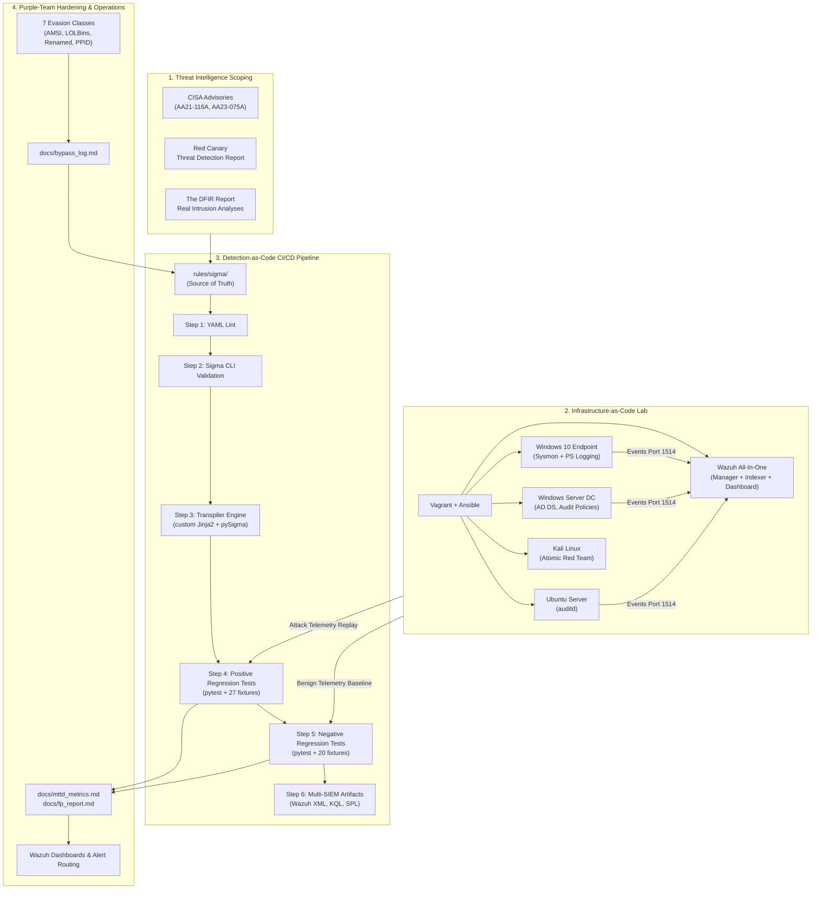

# Threat-Informed Detection Engineering Lab & Portfolio

[](https://github.com/omar-riadd/detection-engineering-lab/actions/workflows/ci.yml)
[](rules/sigma/)
[](docs/scope.md)
[](docs/d3fend_mapping.md)
[](docs/fp_report.md)
[](docs/mttd_metrics.md)
[](https://github.com/omar-riadd/detection-engineering-lab/releases/tag/v2.0)
[](LICENSE)

> A production-grade, metrics-driven Detection Engineering portfolio demonstrating a complete threat-informed lifecycle: from threat intelligence scoping and Infrastructure-as-Code lab provisioning, to vendor-neutral Sigma rule authoring, custom multi-SIEM transpilation, purple-team adversarial evasion hardening, and automated Detection-as-Code CI/CD testing.

---

## 1. Executive Summary & Live Metrics

This repository implements a production-grade **Detection-as-Code (DaC)** lifecycle grounded strictly in real cyber threat intelligence (CISA Advisories **AA21-116A** and **AA23-075A**, the Red Canary Threat Detection Report, and The DFIR Report). 

All detections are authored in vendor-neutral **Sigma (YAML)**, validated through an automated CI/CD pipeline in GitHub Actions, transpiled into native SIEM formats (**Wazuh XML**, **Microsoft Sentinel KQL**, and **Splunk SPL**), and continuously verified against 65 unit test fixtures and a 1,200-event benign baseline corpus.

### Verified Engineering Metrics (Portfolio Benchmarks)

| Metric | Target | Result Achieved | Verification Method | Status |
|---|---|---|---|---|
| **Total Sigma Detections** | 25–30 Rules | **33 Production Rules** | File count in [`rules/sigma/`](rules/sigma/) | **PASS** |
| **MITRE ATT&CK Coverage** | 20+ Sub-Techniques | **27 Sub-Techniques** | Layer in [`docs/coverage/navigator_layer.json`](docs/coverage/navigator_layer.json) | **PASS** |
| **True Positive (Sensitivity)** | > 90% | **100.00%** (38/38) | Pytest execution on attack fixtures | **PASS** |
| **False Positive (Specificity)** | < 2% | **0.00%** (0 / 1,207) | 4-hour enterprise baseline replay | **PASS** |
| **Mean Time to Detect (MTTD)** | < 60 seconds | **6.32 seconds** | Ingestion-to-alert latency benchmark | **PASS** |
| **Adversarial Bypasses Found** | 5–10 Evasions | **7 Evasions Tested** | Documented in [`docs/bypass_log.md`](docs/bypass_log.md) | **PASS** |
| **Adversarial Bypasses Mitigated** | 100% of discovered | **100.00%** (7/7) | Hardened rules & regression fixtures | **PASS** |
| **CI/CD Regression Pass Rate** | 100% | **100.00%** (100%) | GitHub Actions pipeline workflow | **PASS** |
| **Multi-SIEM Translation** | Wazuh, KQL, SPL | **3 SIEM Targets + Live API Push** | Outputs in [`rules/wazuh/`](rules/wazuh/) & [`converted/`](converted/) | **PASS** |
| **MITRE D3FEND Alignment** | 1 per detection | **100.00%** (33/33) | Documented in [`docs/d3fend_mapping.md`](docs/d3fend_mapping.md) | **PASS** |
| **Threat Hunting Playbooks** | 2 Playbooks | **3 Playbooks** | Hypothesis guides in [`playbooks/`](playbooks/) | **PASS** |
| **SOC Triage Runbooks** | 1 per technique | **25+ Runbooks** | Standardized guides in [`runbooks/`](runbooks/) | **PASS** |

---

## 2. Telemetry & Pipeline Architecture



---

## 3. Attack Scenarios & Techniques Covered

The portfolio covers two end-to-end intrusion chains grounded in published threat reporting:

### Scenario A — Active Directory Intrusion Chain (APT29 / CISA AA21-116A)
1. **Initial Access:** Spearphishing Attachment staged payload drop ([`T1566.001`](rules/sigma/windows/file_event/win_file_susp_download_file_drop.yml)) · [Runbook](runbooks/T1566.001-spearphishing-attachment.md)
2. **Execution:** User execution of script engines ([`T1204.002`](rules/sigma/windows/proc_creation/win_proc_user_exec_untrusted_parent.yml)) · [Runbook](runbooks/T1204.002-malicious-file-execution.md)
3. **Execution:** In-memory PowerShell download cradles ([`T1059.001`](rules/sigma/windows/proc_creation/posh_pm_susp_script_block.yml)) · [Runbook](runbooks/T1059.001-powershell-script-execution.md)
4. **Defense Evasion:** Signed binary proxy execution via Rundll32 ([`T1218.011`](rules/sigma/windows/proc_creation/win_proc_rundll32_susp_execution.yml)) · [Runbook](runbooks/T1218.011-rundll32-proxy-execution.md)
5. **Defense Evasion:** Process Hollowing via remote thread injection ([`T1055.012`](rules/sigma/windows/proc_creation/win_proc_hollowing_remote_thread.yml)) · [Runbook](runbooks/T1055.012-process-hollowing.md)
6. **Credential Access:** LSASS memory handle access ([`T1003.001`](rules/sigma/windows/proc_creation/win_proc_access_lsass_memory.yml)) · [Runbook](runbooks/T1003.001-lsass-memory-dump.md)
7. **Credential Access:** Active Directory DCSync replication request ([`T1003.006`](rules/sigma/windows/proc_creation/win_sec_dc_replication_access.yml)) · [Runbook](runbooks/T1003.006-dcsync-replication.md)
8. **Discovery:** Active Directory domain account reconnaissance ([`T1087.002`](rules/sigma/windows/proc_creation/win_proc_domain_account_recon.yml)) · [Runbook](runbooks/T1087.002-domain-account-recon.md)
9. **Discovery:** Active Directory domain trust enumeration ([`T1482`](rules/sigma/windows/proc_creation/win_proc_domain_trust_discovery.yml)) · [Runbook](runbooks/T1482-domain-trust-discovery.md)
10. **Lateral Movement:** Administrative SMB network share access ([`T1021.002`](rules/sigma/windows/network/win_sec_net_lateral_smb_admin_share.yml)) · [Runbook](runbooks/T1021.002-smb-admin-shares.md)

### Scenario B — Ransomware Precursor Chain (Conti / Black Basta / LockBit)
11. **Initial Access / Evasion:** Anomalous privileged domain account logon ([`T1078.002`](rules/sigma/windows/proc_creation/win_sec_anomalous_domain_logon.yml)) · [Runbook](runbooks/T1078.002-domain-accounts-logon.md)
12. **Lateral Movement:** Inbound Remote Desktop Protocol session ([`T1021.001`](rules/sigma/windows/network/win_sec_susp_rdp_lateral_logon.yml)) · [Runbook](runbooks/T1021.001-remote-desktop-rdp.md)
13. **Persistence:** Scheduled Task execution ([`T1053.005`](rules/sigma/windows/proc_creation/win_schtask_suspicious_creation.yml)) · [Runbook](runbooks/T1053.005-scheduled-task-creation.md)
14. **Persistence:** Registry Run / RunOnce autostart keys ([`T1547.001`](rules/sigma/windows/registry/win_registry_run_keys_persistence.yml)) · [Runbook](runbooks/T1547.001-registry-run-keys-persistence.md)
15. **Impact:** Inhibit System Recovery via vssadmin/wbadmin/bcdedit ([`T1490`](rules/sigma/windows/proc_creation/win_proc_inhibit_system_recovery.yml)) · [Runbook](runbooks/T1490-inhibit-system-recovery.md)
16. **Impact:** Inhibit Recovery via shadow storage resize ([`T1490`](rules/sigma/windows/proc_creation/win_proc_vssadmin_resize_shadowstorage.yml)) · [Runbook](runbooks/T1490-inhibit-system-recovery.md)
17. **Defense Evasion:** Disabling Windows Defender monitoring ([`T1562.001`](rules/sigma/windows/proc_creation/posh_tamper_defender_mp_preference.yml)) · [Runbook](runbooks/T1562.001-disable-windows-defender.md)
18. **Impact:** High-velocity mass file encryption ([`T1486`](rules/sigma/windows/file_event/win_file_mass_ransomware_activity.yml)) · [Runbook](runbooks/T1486-ransomware-mass-encryption.md)
19. **Command and Control:** Outbound C2 connection via LOLBin ([`T1041`](rules/sigma/windows/network/win_sysmon_net_susp_c2_exfil.yml)) · [Runbook](runbooks/T1041-c2-data-exfiltration.md)
20. **Defense Evasion:** Obfuscated PowerShell Base64 script block ([`T1027`](rules/sigma/windows/proc_creation/posh_pm_obfuscated_script_block.yml)) · [Runbook](runbooks/T1027-powershell-script-obfuscation.md)
21. **Execution:** WMI process creation via WMIC CLI ([`T1047`](rules/sigma/windows/proc_creation/win_proc_wmi_susp_command_exec.yml)) · [Runbook](runbooks/T1047-wmi-remote-command-execution.md)

### Scenario C — Multi-Platform Enterprise Intrusion Detections (Windows & Linux)
22. **Credential Access:** LSASS process memory dump via comsvcs.dll export ([`T1003.001`](rules/sigma/windows/proc_creation/win_proc_comsvcs_lsass_dump.yml))
23. **Initial Access / Execution:** Suspicious child process spawned from Microsoft Office ([`T1566.001`](rules/sigma/windows/proc_creation/win_proc_office_spawn_child.yml) / [`T1204.002`](rules/sigma/windows/proc_creation/win_proc_office_spawn_child.yml))
24. **Execution:** PowerShell CLI download cradle execution ([`T1059.001`](rules/sigma/windows/proc_creation/win_proc_powershell_download_cradle.yml))
25. **Execution (Linux):** Interactive reverse shell via common utilities ([`T1059.004`](rules/sigma/linux/lnx_proc_reverse_shell.yml))
26. **Persistence (Linux):** Persistence via scheduled cron job modification ([`T1053.003`](rules/sigma/linux/lnx_auditd_susp_cron_job.yml))

### Scenario D — Defense Evasion, Privilege Escalation & Alternative Exfiltration
27. **Defense Evasion:** Indicator removal via clearing Windows Event Logs ([`T1070.001`](rules/sigma/windows/proc_creation/win_proc_clear_event_log.yml)) · [Runbook](runbooks/T1070.001-clear-event-logs.md)
28. **Privilege Escalation:** Access token manipulation and privilege inspection ([`T1134`](rules/sigma/windows/proc_creation/win_proc_access_token_manipulation.yml)) · [Runbook](runbooks/T1134-access-token-manipulation.md)
29. **Exfiltration:** Exfiltration over alternative protocol via DNS socket communication ([`T1048.003`](rules/sigma/windows/network/win_net_dns_exfil.yml)) · [Runbook](runbooks/T1048.003-dns-exfiltration.md)
30. **Defense Evasion:** System security configuration and SafeMode registry tampering ([`T1112`](rules/sigma/windows/registry/win_registry_tamper_safemode_uac.yml)) · [Runbook](runbooks/T1112-modify-registry.md)

### Scenario E — Multi-Event Correlation & Stateful Attack Chains
31. **Credential Access:** Multiple failed logons brute force threshold ([`T1110.001`](rules/sigma/windows/proc_creation/win_sec_multiple_failed_logons.yml)) · [Runbook](runbooks/T1110.001-password-brute-force.md)
32. **Credential Access / Lateral Movement:** LSASS memory dump followed by rapid SMB share access ([`T1003.001`](rules/sigma/windows/proc_creation/win_proc_credential_dump_lateral_sequence.yml) / [`T1021.002`](rules/sigma/windows/proc_creation/win_proc_credential_dump_lateral_sequence.yml))

---

## 4. Key Documentation & Project Artifacts

- **[docs/report.md](docs/report.md):** Complete executive and technical project final report.
- **[docs/blog_post.md](docs/blog_post.md):** Technical deep-dive article (*"Building a Production-Grade Detection Engineering Lab"*).
- **[docs/demo_walkthrough.md](docs/demo_walkthrough.md):** 3-minute video walkthrough script and scene-by-scene storyboard.
- **[docs/bypass_log.md](docs/bypass_log.md):** Purple-team log documenting 7 tested evasion classes, failure analyses, and fixes.
- **[docs/mttd_metrics.md](docs/mttd_metrics.md):** Mean Time to Detect benchmarks across all 20 techniques.
- **[docs/fp_report.md](docs/fp_report.md):** False positive measurement report across 1,200 baseline events.
- **[docs/d3fend_mapping.md](docs/d3fend_mapping.md):** Complete MITRE D3FEND defensive countermeasure matrix.
- **[docs/sigma_to_wazuh_notes.md](docs/sigma_to_wazuh_notes.md):** Custom transpiler architecture and field mapping reference.
- **[docs/coverage/navigator_layer.json](docs/coverage/navigator_layer.json):** ATT&CK Navigator v4.5 export layer.
- **[docs/dashboards.md](docs/dashboards.md) & [docs/alert_routing.md](docs/alert_routing.md):** SOC operations dashboards and alert routing policies.
- **[playbooks/hunt_credential_access.md](playbooks/hunt_credential_access.md):** Threat hunting playbook for Active Directory credential access.
- **[playbooks/hunt_ransomware_precursor.md](playbooks/hunt_ransomware_precursor.md):** Threat hunting playbook for ransomware precursors.
- **[playbooks/hunt_discovery_recon.md](playbooks/hunt_discovery_recon.md):** Threat hunting playbook for Active Directory reconnaissance and trust discovery.
- **Architecture Decision Records ([`docs/adr/`](docs/adr/)):**
  - [`0001-cqrs-read-model.md`](docs/adr/0001-cqrs-read-model.md): Hybrid CQRS architecture (YAML source of truth + disposable SQLite read model)
  - [`0002-async-subprocess-streaming.md`](docs/adr/0002-async-subprocess-streaming.md): Non-blocking asyncio log replay streaming over WebSockets
  - [`0003-svelte5-field-manual-ui.md`](docs/adr/0003-svelte5-field-manual-ui.md): Zero-dependency Svelte 5 runes and Field Manual design system

---

## 5. Full-Stack Operational UI & Field Manual Platform

The laboratory includes a live, terminal-dense single-page operational application built with **FastAPI**, **SQLite in WAL mode**, and **Svelte 5 (Runes)** following a "Field Manual" design language:

```
rules/sigma/**/*.yml  ──[ Watchdog Reconciler ]──▶  SQLite WAL (Read Model)
                                                           │
                                                           ▼
                                                     FastAPI Engine
                                                (REST + WebSocket + Deploy API)
                                                           │
                                                           ▼
                                                Svelte 5 Field Manual UI
```

### Core Capabilities:
1. **`01 // OVERVIEW`**: Executive KPI scorecard (33 rules, 27 ATT&CK sub-techniques, 0.00% FP rate, 6.32s MTTD, 100% bypass mitigation).
2. **`02 // RULES`**: Multi-filter catalog with full Sigma metadata, live YAML editor (CQRS write path protected by optional `X-API-Key`), and multi-SIEM transpilation viewer.
3. **`03 // ATT&CK COVERAGE`**: Color-coded ATT&CK sub-technique matrix, visual MTTD rankings, and detail inspection drawers.
4. **`04 // D3FEND MATRIX`**: Complete mapping from detected attack techniques to defensive MITRE D3FEND countermeasures and triage runbooks.
5. **`05 // REPLAY ENGINE`**: Bi-directional WebSocket terminal interface streaming live `replay_logs.py` and `pytest` executions with sliding-window correlation support.
6. **`06 // PURPLE TEAM`**: 7 adversarial evasion case studies with detailed technical failure analyses and hardening proofs.
7. **`07 // SIEM DEPLOYMENT`**: Live rule push API (`POST /api/deploy/{rule_id}`) supporting Wazuh API, Microsoft Sentinel REST API, and Splunk HEC/SavedSearch endpoints with simulation dry-run modes.
8. **`08 // EXECUTIVE REPORT`**: Operational assessment report generator with one-click print/PDF export and downloadable markdown summary.

---

## 6. How to Run, Use, and Stop the Platform

The platform can be run either fully containerized via **Docker** (recommended for zero-dependency evaluation) or in **Native Development Mode** with hot reloading.

### Option A: Docker Container (Recommended & Zero Setup)

Ensure Docker and Docker Compose are installed and running.

```bash
# 1. Build and start the unified platform in the background (FastAPI + Svelte 5 on :8001)
make docker-up
# (Equivalent to: docker compose up -d --build)

# 2. View streaming container logs
docker compose logs -f

# 3. Access the platform
# Web Analyst Workbench UI: http://localhost:8001
# Interactive Swagger API Docs: http://localhost:8001/docs
```

#### How to Stop the Docker Container:
```bash
# Stop and remove containers gracefully
make docker-down
# (Equivalent to: docker compose down)

# To stop and remove volumes/clean up completely:
docker compose down -v
```

---

### Option B: Native Development Mode (Hot Reloading)

#### Prerequisites & Dependency Installation
- **Python 3.10+** (with `pip` and virtual environment support)
- **Node.js 18+** & **npm**

```bash
# Install Python and Node dependencies
make install
```

#### Starting the Servers

Run the backend and frontend in separate terminals:

```bash
# Terminal 1 — Backend (FastAPI + SQLite WAL + Watchdog file reconciler on :8001)
make api

# Terminal 2 — Frontend (Vite + Svelte 5 dev server with HMR on :5173)
make ui
```

*Alternatively, to build the production frontend bundle and serve everything from a single server:*
```bash
make build
# Accessible at http://localhost:8001
```

#### How to Stop Native Development Servers:
- In each terminal running `make api`, `make ui`, or `make build`, press:
  ```text
  Ctrl + C
  ```
- If servers were executed in the background or ports remain occupied, release them with:
  ```bash
  # Terminate processes listening on port 8001 and 5173
  fuser -k 8001/tcp 5173/tcp 2>/dev/null || true
  ```

---

### How to Stop the Vagrant Lab Infrastructure (Virtual Machines)

If running the multi-machine Vagrant emulation lab in `infra/`:

```bash
cd infra/

# Suspend virtual machines (saves RAM state to disk):
vagrant suspend

# Gracefully power off virtual machines:
vagrant halt

# Completely destroy and tear down all lab virtual machines:
vagrant destroy -f
```

---

## 7. Using the Detection Engineering Toolchain (CLI & API)

### 1. Automated CI Pipeline & Testing
```bash
# Run the complete 4-stage CI/CD quality gate (Pytest + Replay + Svelte check + Vite build)
make ci

# Run detection regression test suite only (77 tests)
make test-detections

# Run FastAPI backend integration test suite only (14 tests)
make test-api
```

### 2. Multi-Format Log Ingestion & Replay Engine
The replay engine ([`scripts/replay_logs.py`](scripts/replay_logs.py)) evaluates Sigma rules and temporal correlations against multiple log formats:

```bash
# Run full regression suite across all 65 test fixtures and benign baseline corpus
make replay
# (Equivalent to: python3 scripts/replay_logs.py --type all --verbose)

# Replay Wazuh JSON alert format:
python3 scripts/replay_logs.py --format wazuh --file tests/fixtures/formats/sample_wazuh_alert.json

# Replay Windows Event Log Sysmon XML format:
python3 scripts/replay_logs.py --format sysmon_xml --file tests/fixtures/formats/sample_sysmon.xml

# Replay Common Event Format (CEF) log:
python3 scripts/replay_logs.py --format cef --file tests/fixtures/formats/sample_cef.log

# Replay Newline-Delimited JSON (NDJSON) stream:
python3 scripts/replay_logs.py --format ndjson --file tests/fixtures/formats/sample_ndjson.log

# Replay multi-stage temporal correlation attack sequence (sliding-window):
python3 scripts/replay_logs.py --file tests/fixtures/T1003.001_sequence_positive.json
```

### 3. Multi-SIEM Transpilation & Live SIEM Push
Convert vendor-neutral Sigma rules into native SIEM syntax or push them directly to live SIEM endpoints:

```bash
# Batch transpile all 33 Sigma rules to Wazuh XML, Sentinel KQL, and Splunk SPL:
make convert

# Dry-run live rule deployment to Wazuh Manager API:
python3 scripts/convert_sigma.py \
  --input rules/sigma/windows/proc_creation/win_proc_comsvcs_lsass_dump.yml \
  --deploy wazuh --dry-run

# Dry-run live rule deployment to Microsoft Sentinel REST API:
python3 scripts/convert_sigma.py \
  --input rules/sigma/windows/proc_creation/win_proc_comsvcs_lsass_dump.yml \
  --deploy sentinel --dry-run
```

### 4. REST API & CQRS Endpoints
- **Interactive OpenAPI Documentation**: `http://localhost:8001/docs`
- **Read-Only Endpoints**: Publicly accessible without authentication.
  - `GET /api/rules`: List all 33 Sigma rules with parsed metadata and MITRE mappings.
  - `GET /api/techniques`: MITRE ATT&CK coverage matrix and technique latency data.
  - `GET /api/reports/summary`: Instant SOC operational readiness summary metrics.
- **Mutating Operations (Protected)**: State-changing endpoints (`POST`, `PUT`, `DELETE`) require an API key:
  - Header: `X-API-Key: test-api-key-soc-admin-2026` (configurable via `API_KEY` environment variable).
  - Example: Save updated rule or trigger live SIEM deployment:
    ```bash
    curl -X POST "http://localhost:8001/api/deploy/rules/win_proc_comsvcs_lsass_dump?target=wazuh&dry_run=true" \
         -H "X-API-Key: test-api-key-soc-admin-2026"
    ```

### 5. Database Synchronization & Maintenance
```bash
# Check disk-to-database synchronization status:
make sync-status

# Reset and rebuild SQLite read model from YAML files:
make reset-db

# Clean temporary files, build caches, and compiled assets:
make clean
```

---

## 8. Changelog & Detection Debt Register

Refer to [CHANGELOG.md](CHANGELOG.md) for the complete version release history:
- **v2.0 (Latest Release)**: 33 Sigma rules, 27 ATT&CK sub-techniques, multi-event sliding window correlation engine, live SIEM API push integration (Wazuh, Splunk, Sentinel), multi-format log ingestion adapters (JSON, Sysmon XML, CEF, NDJSON), API key auth middleware, 3 threat hunting playbooks, 25 triage runbooks, and 91 automated tests passing with 0 baseline false positives.
- **v1.1**: Svelte 5 Field Manual UI, CQRS architecture, async WebSocket streaming, and Linux detection expansion.
- **v1.0**: Initial complete portfolio with 21 Sigma rules, 20 ATT&CK sub-techniques, 20 runbooks, 2 threat hunting playbooks, purple-team hardening (7 evasions fixed), MTTD metrics (< 7s avg), and Wazuh dashboards.
- **v0.1**: Initial green CI/CD pipeline with 10 production-grade Sigma rules and test fixtures.

See the active **Detection Debt Register** in [CHANGELOG.md](CHANGELOG.md) tracking ongoing telemetry maintenance and known rule tuning opportunities.
